# Kubernetes Cluster Setup, Deployment, Scaling & Self-Healing Using Kind

<p align="center">
  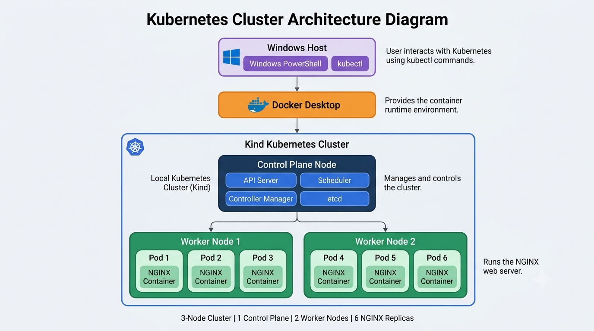
</p>

<p align="center">
  <b>A hands-on Cloud Computing experiment using Docker, Kubernetes, Kind and NGINX.</b>
</p>

---

##  1. Project Overview

This experiment demonstrates how to create and manage a local multi-node Kubernetes cluster using **Kind (Kubernetes IN Docker)**.

The experiment covers cluster configuration, cluster creation, application deployment, replica scaling and Kubernetes self-healing.

A three-node Kubernetes cluster is created with one Control Plane node and two Worker nodes. An NGINX application is deployed, scaled from three to six replicas, and tested by manually deleting running Pods to observe automatic recovery.

##  2. Objectives

- Understand Kubernetes cluster architecture.
- Create a multi-node Kubernetes cluster using Kind.
- Understand the roles of Control Plane and Worker Nodes.
- Deploy an NGINX application using a Kubernetes Deployment.
- Scale application replicas from 3 to 6.
- Demonstrate Kubernetes self-healing.
- Verify cluster and application status using kubectl.

##  3. Technologies Used

| Technology | Purpose |
|---|---|
| Docker Desktop | Container runtime environment |
| Kubernetes | Container orchestration |
| Kind | Local Kubernetes cluster creation |
| kubectl | Kubernetes command-line interface |
| NGINX | Sample web server application |
| Windows PowerShell | Command execution environment |

## 💻 4. Environment Setup

The experiment was performed on Windows using PowerShell.

| Component | Version |
|---|---|
| Operating System | Windows |
| Docker Desktop | 4.92.0 |
| Docker Engine | 29.8.0 |
| kubectl | v1.36.1 |
| Kind | v0.33.0 |
| Kubernetes Node Image | v1.37.0 |
| Architecture | Windows AMD64 |

### Tool Verification

```powershell
docker version
kubectl version --client
kind version
```

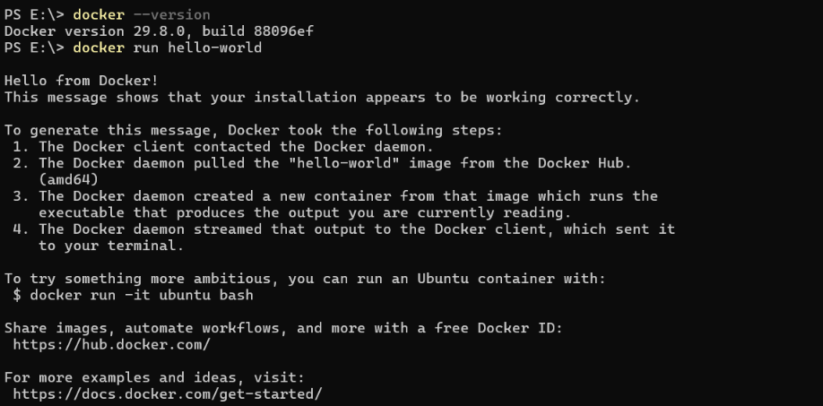

##  5. System Architecture

The experiment uses a local Kubernetes cluster created using Kind.

- **Windows Host:** Provides the PowerShell environment.
- **kubectl:** Sends commands to the Kubernetes cluster.
- **Docker Desktop:** Provides the container runtime.
- **Kind:** Creates and manages the local Kubernetes cluster.
- **Control Plane:** Manages the cluster and its resources.
- **Worker Nodes:** Run the application Pods.
- **NGINX Pods:** Run the NGINX application containers.

### Architecture Diagram

<p align="center">
  
</p>

### Cluster Configuration

The cluster contains:

| Node | Role |
|---|---|
| kind-control-plane | Control Plane |
| kind-worker | Worker Node |
| kind-worker2 | Worker Node |

##  6. Experiment Workflow

The experiment follows this sequence:

1. Verify the required tools.
2. Define the cluster configuration.
3. Create and verify the Kubernetes cluster.
4. Deploy NGINX with three replicas.
5. Scale the application to six replicas.
6. Simulate failure by deleting running Pods.
7. Observe Kubernetes self-healing.
8. Perform final verification.

### Workflow Diagram

<p align="center">
  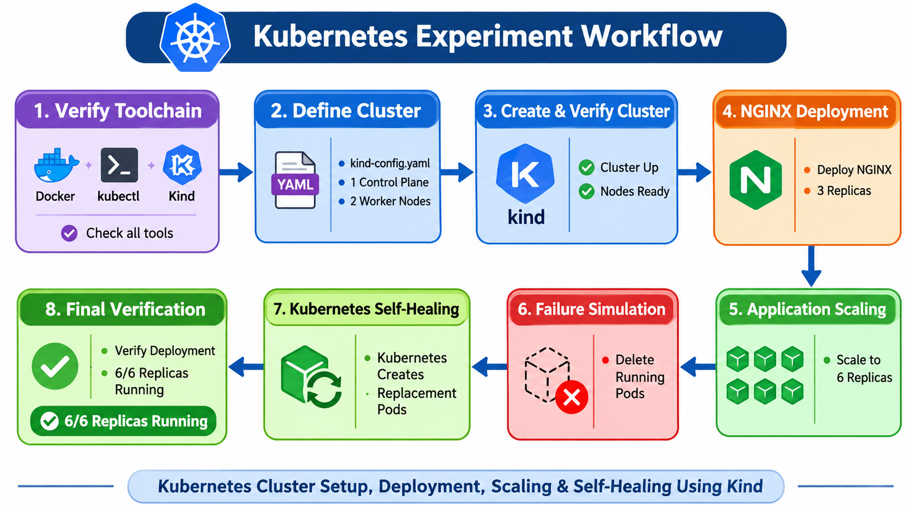
</p>

---

#  7. Implementation

## Step 1: Configure the Kubernetes Cluster

Create a file named `kind-config.yaml`.

```yaml
kind: Cluster
apiVersion: kind.x-k8s.io/v1alpha4
nodes:
  - role: control-plane
  - role: worker
  - role: worker
```

This configuration defines a three-node Kubernetes cluster consisting of one Control Plane and two Worker Nodes.

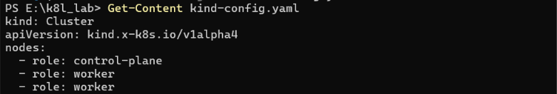

## Step 2: Create the Kubernetes Cluster

Execute the following command:

```powershell
kind create cluster --config kind-config.yaml
```

Kind creates the cluster using Docker containers as Kubernetes nodes.

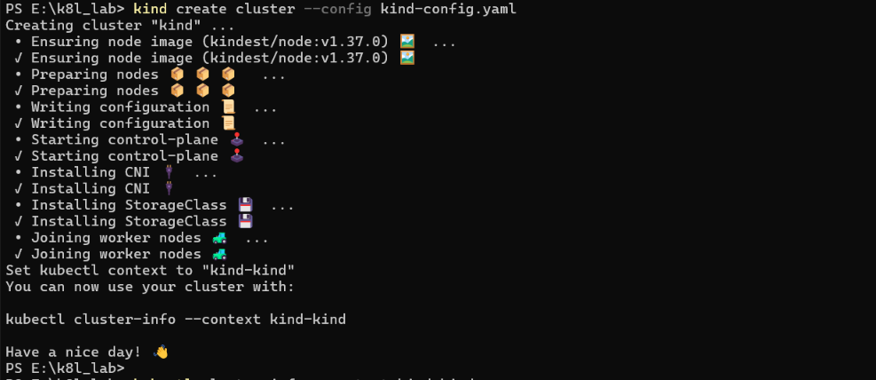

## Step 3: Verify Cluster Information

Check whether the Kubernetes cluster is accessible.

```powershell
kubectl cluster-info --context kind-kind
```

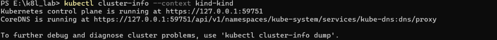

## Step 4: Verify Cluster Nodes and System Pods

Check the available nodes:

```powershell
kubectl get nodes
```

Check the Docker containers representing the Kind nodes:

```powershell
docker ps
```

Check the Kubernetes system Pods:

```powershell
kubectl get pods -n kube-system -o wide
```

All three cluster nodes should reach the `Ready` state, and the system Pods should become operational.

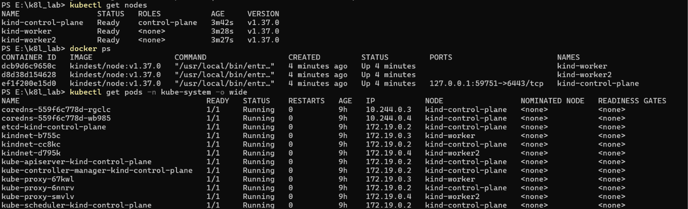

## Step 5: Deploy the NGINX Application

Create a Kubernetes Deployment with three replicas.

```powershell
kubectl create deployment web --image=nginx --replicas=3
```

Check the Deployment and Pods:

```powershell
kubectl get deployments
kubectl get pods -o wide
```

Initially, the Pods may show `ContainerCreating` while their containers are being prepared.

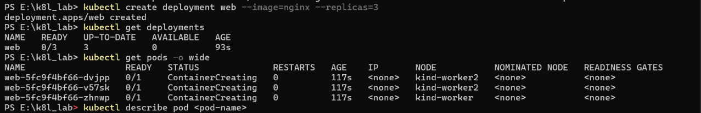

After the containers start successfully, all three Pods reach the `Running` state.

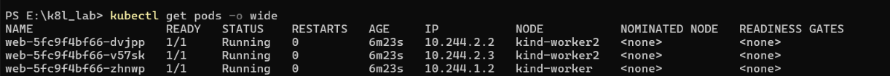

## Step 6: Scale the Application

Increase the number of NGINX replicas from three to six.

```powershell
kubectl scale deployment web --replicas=6
```

Verify the updated Deployment:

```powershell
kubectl get deployments
kubectl get pods -o wide
```

Kubernetes updates the desired replica count and creates additional Pods to reach six replicas.

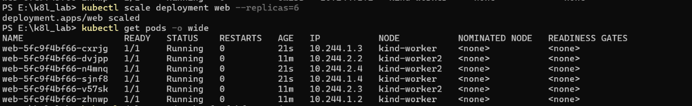

## Step 7: Demonstrate Kubernetes Self-Healing

To simulate a failure, manually delete a running Pod.

```powershell
kubectl delete pod <pod-name>
```

Replace `<pod-name>` with the name of an existing NGINX Pod.

Observe the Pods again:

```powershell
kubectl get pods -o wide
```

The Deployment's ReplicaSet detects that the number of available Pods is below the desired replica count and creates a replacement Pod.

The replacement Pod receives a new name. Kubernetes does not restore the deleted Pod itself.

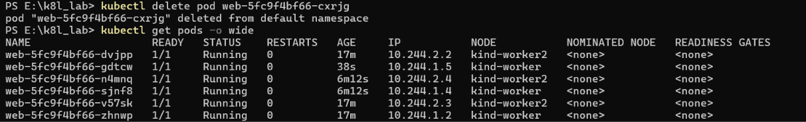

## Step 8: Final Verification

Verify the Deployment:

```powershell
kubectl get deployments
```

Verify all application Pods:

```powershell
kubectl get pods -o wide
```

Verify the cluster nodes:

```powershell
kubectl get nodes
```

The final result confirms:

- Deployment desired replicas: 6
- Deployment ready replicas: 6
- Deployment available replicas: 6
- All six NGINX Pods: Running

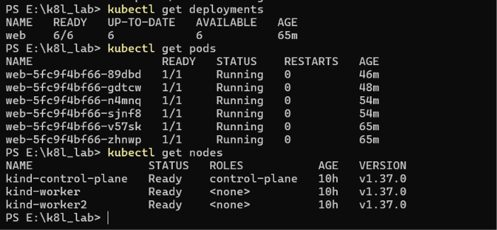

---

#  8. Experimental Results

| Experiment | Expected / Observed Result |
|---|---|
| Cluster Creation | 3 nodes created |
| Node Verification | All nodes Ready |
| NGINX Deployment | 3 replicas Running |
| Application Scaling | 6 replicas Running |
| Pod Deletion | Pod successfully deleted |
| Self-Healing | Replacement Pod created |
| Final Verification | 6/6 replicas available |

##  9. Key Concepts Learned

### Kubernetes Cluster
A collection of nodes managed by Kubernetes to run containerized applications.

### Control Plane
The component responsible for managing the cluster, scheduling workloads and maintaining the desired state.

### Worker Node
A node that runs application workloads in the form of Pods.

### Pod
The smallest deployable unit in Kubernetes. It contains one or more containers.

### Deployment
A Kubernetes resource that manages application replicas and maintains the desired state.

### Scaling
The process of increasing or decreasing the number of application replicas.

### Self-Healing
Kubernetes automatically replaces missing Pods to maintain the desired replica count managed by the Deployment.

### Kind
Kind stands for Kubernetes IN Docker. It allows users to run local Kubernetes clusters using Docker containers as nodes.

---

#  10. Conclusion

This experiment successfully demonstrated the creation and management of a multi-node Kubernetes cluster using Kind.

An NGINX application was deployed with three replicas and subsequently scaled to six replicas. Pod deletion was used to simulate failure, and Kubernetes successfully created replacement Pods to maintain the desired replica count.

Through this experiment, the fundamental concepts of Kubernetes cluster management, application deployment, scaling and self-healing were explored practically.

---

##  Experiment Information

**Experiment:** Kubernetes Cluster Setup, Deployment, Scaling & Self-Healing Using Kind

**Environment:** Windows PowerShell

**Cluster:** Kind – 1 Control Plane + 2 Worker Nodes

**Application:** NGINX

**Final Deployment:** 6/6 Replicas Running
